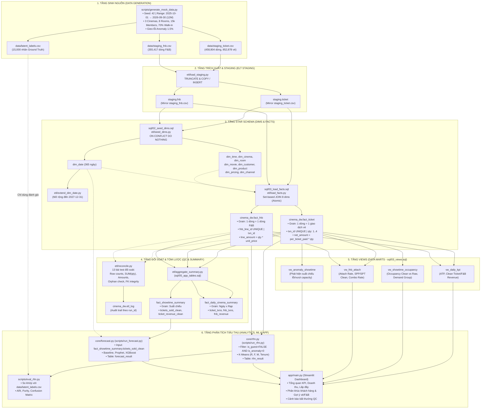

# TÀI LIỆU DÒNG CHẢY DỮ LIỆU TOÀN HỆ THỐNG (DATA LINEAGE)

**Dự án:** Hệ thống phân tích hành vi khách hàng và hỗ trợ quyết định vận hành rạp phim  
**Mã tài liệu:** `NCKH-CINEMA-DOC-LINEAGE-01`  
**Phiên bản:** 2.0 (Chuẩn hóa Task 5)  
**Trạng thái:** Hoàn thiện  

---

## 1. Sơ đồ Dòng chảy Dữ liệu Tổng thể (End-to-End Data Lineage)

Dưới đây là sơ đồ chi tiết biểu diễn sự dịch chuyển, biến đổi và tiêu thụ dữ liệu qua các tầng: từ tạo nguồn Mock Data, qua Staging, Data Warehouse (Star Schema), Tầng Tóm lược (Summary), Tầng Views (Data Mart), đến các mô hình Phân tích / Học máy (RFM, Forecasting) và Ứng dụng Streamlit Dashboard:

---

## 2. Chi tiết Biến đổi & Chuyển giao qua từng Công đoạn

### Giai đoạn 1: Sinh nguồn (Mock Generation)
- **Công cụ:** `scripts/generate_mock_data.py`.
- **Cơ chế:** Dựa trên các bảng phân phối xác suất thực tế (khung giờ, thể loại phim, độ tuổi phim, ngày lễ/cuối tuần).
- **Đặc trưng:**
  - Nhóm khách theo đoàn: $1 \le \text{party} \le 4$.
  - Lưu trữ dưới dạng giao dịch vé: `qty = party`, `net_amount = per_ticket_paid * party`, `discount_amount = per_ticket_discount * party`.
  - Gieo nhãn bất thường $1.5\%$ với 3 dạng: `price_zero`, `revenue_mismatch`, `qty_spike`.
  - Sinh file nhãn tiềm ẩn `data/latent_labels.csv` riêng biệt, không đưa vào luồng ETL nạp kho.

### Giai đoạn 2: Nạp Staging (ELT Extract & Load)
- **Công cụ:** `etl/load_staging.py` (hoặc `sql/01b_etl_support.sql`).
- **Bảng đích:** `staging.ticket`, `staging.fnb`.
- **Cơ chế:** TRUNCATE và tải nguyên vẹn dữ liệu từ file CSV, giữ định dạng văn bản thô để đảm bảo tốc độ nạp cao nhất.

### Giai đoạn 3: Nạp Star Schema (SQL Set-Based Transformation)
- **Công cụ:** `sql/02_seed_dims.sql` và `sql/03_load_facts.sql` (bọc bởi `etl/load_facts.py`).
- **Cơ chế:**
  - `dim_date`: Khởi tạo bằng `generate_series` toàn bộ chu kỳ 12 tháng (`2025-10-01` đến `2026-09-30`), sau đó được mở rộng đến `2027-12-31` bằng `etl/extend_dim_date.py`.
  - Các dimension khác (`dim_movie`, `dim_customer`, `dim_pricing`...): Trích xuất `DISTINCT` kèm ép kiểu dữ liệu từ staging bảng `ON CONFLICT DO NOTHING`.
  - `fact_ticket`: JOIN 8 dimension (`dim_date`, `dim_time`, `dim_movie`, `dim_cinema`, `dim_room`, `dim_customer`, `dim_pricing`, `dim_channel`) để tra surrogate key.
  - `fact_fnb`: JOIN 6 dimension. Ràng buộc `WHERE EXISTS` đảm bảo `txn_id` phải tồn tại trong giao dịch vé (loại bỏ triệt để F&B mồ côi).

### Giai đoạn 4: Đối soát & Tổng hợp tóm lược (Reconciliation & Summarization)
- **Đối soát:** `etl/reconcile.py` chạy 13 truy vấn kiểm tra chéo (số dòng, tổng `qty`, tổng tiền, khóa ngoại, tỷ lệ bất thường), ghi nhật ký kiểm định vào `cinema_dw.etl_log`.
- **Tổng hợp:** `etl/aggregate_summary.py` nhóm số liệu từ fact sang:
  - `fact_showtime_summary`: Cấp suất chiếu (`date_key`, `time_key`, `room_key`).
  - `fact_daily_cinema_summary`: Cấp ngày × rạp (`date_key`, `cinema_key`).

### Giai đoạn 5: Tiêu thụ phân tích & Mô hình hóa (Consumption)
- **Mô hình RFM (`core/rfm.py`):** Lọc dữ liệu khách hàng sạch (`is_guest = FALSE` và `is_anomaly = 0`), tính toán 4 chỉ số $R, F, M, \text{Tenure}$ và phân cụm K-Means. Kết quả được lưu tại bảng `cinema_dw.rfm_result`.
- **Đánh giá Ground Truth (`scripts/eval_rfm.py`):** Đọc nhãn tiềm ẩn từ `data/latent_labels.csv` để đo độ tương đồng ARI và Purity so với cụm K-Means. Nhãn tiềm ẩn **không tham gia** quá trình huấn luyện.
- **Mô hình Dự báo (`core/forecast.py`):** Đọc chuỗi thời gian `tickets_sold_clean` từ `fact_showtime_summary` gộp theo ngày × rạp × khung giờ. Huấn luyện Baseline, Prophet, XGBoost và lưu kết quả dự báo 14 ngày tương lai vào bảng `cinema_dw.forecast_result`.
- **Giao diện người dùng (`app/main.py`):** Đọc trực tiếp các views và bảng kết quả phân tích để hiển thị dashboard tương tác.
